<p align="center">
  
</p>

<h1 align="center">DeskPartner</h1>

<p align="center">
  A pixel cat for the Windows desktop. She lives on your screen edges and window frames and stays out of your way.
</p>

<p align="center">
  <a href="https://forecastych.github.io/DeskPartner/">Website</a> ·
  <a href="https://github.com/Forecastych/DeskPartner/releases/latest">Download</a> ·
  <a href="README.ru.md">По-русски</a>
</p>

## What she does

- **Walks and naps** on the taskbar, screen edges and the frames of your windows. She never sits in the middle of the screen.
- **Eats** from a bowl you can drag anywhere, and gets hungry a couple of hours after a meal.
- **Sleeps** on her bed.
- **Sulks** if you annoy her, and remembers it.
- **Watches films** with you and hides during calls.
- **Hunts** a pixel mouse and a laser pointer: hold `Ctrl` on its own for a moment and the cursor turns into a red dot.
- **Plays with yarn** now and then.
- **Talks rarely**: a speech bubble every 10 to 30 minutes, with a fact, a "this day in history" note or a headline on the topics you picked.
- **Has a coat and a character**: grey tabby, ginger, black, tuxedo or calico. Each one sleeps, chats, plays and takes offence a little differently.
- **Grows up**: she starts as a kitten, becomes a teen after 15 days together and a grown cat after a month. Days count only while she is on screen with you. Once she is grown, you can pick any of the three looks in Settings.
- **Keeps you company while you focus**: pick "Focus for 25 minutes" in her menu or the tray, and she naps next to an hourglass without bothering you. When time is up, she stretches and calls you for a 5-minute break, with a laser game if you like.
- **Earns awards and outfits**: milestones like the first ten pets or ten kilometres of mouse travel unlock a bow, a bandana, a bell, a beanie and a crown. Pick what she wears in Stats.
- **Keeps a diary**: every evening a short entry about the day in her own words, in Stats.
- **Brings you a present** after 100 days together: a mouse, whole and clean. Accept it and it stays as a trophy, or turn it down and she takes it away, offended.

Clicks pass through everything except the cat herself, her bowl, bed and speech bubble. She never takes keyboard focus, and she disappears while a game or video runs in exclusive fullscreen.

She does not show up in screenshots or screen recordings (you can change that). The livelier extras are off by default and wait in Settings: a bed, an auto-feeder, chasing your cursor, news, film reviews, game patches and new anime episodes.

## Install

1. Download `DeskPartner_<version>_x64-setup.exe` from [Releases](https://github.com/Forecastych/DeskPartner/releases/latest).
2. Run it. It installs into your user profile, no administrator rights needed.
3. On first launch, give her a name and choose a folder for her data.

Works on Windows 10 and 11.

> [!WARNING]
> **Windows SmartScreen will warn you about the installer.** The installer is not code-signed: a code signing certificate costs money every year, and this is a free hobby project. To install anyway, click **More info → Run anyway**. If you would rather not trust a binary, [build it from source](#build-from-source), it takes a few commands.

**Updates.** Every few hours she asks GitHub whether a new version is out. If there is one, "Update to …" appears in her menu and in the tray; it installs only when you click it, then the app restarts. The installer is checked against a signing key, so a tampered file is refused. You can turn the check off in Settings.

To uninstall, use "Installed apps" in Windows Settings. Your data folder stays where you put it; delete it by hand if you want it gone.

## Controls

| What | How |
| --- | --- |
| Menu | Right-click the cat, or the tray icon |
| Laser pointer | Hold `Ctrl` alone, or pick it in the menu (`Esc` turns it off) |
| Click through the cat | Hold `Alt` while clicking |
| Hide / show | `Ctrl+Alt+H` |
| She wandered off | Tray → "Call your pet" |
| Settings and stats | Tray → "Settings…" / "Stats…" |

## Privacy

- **No analytics, no accounts, no telemetry.**
- **Window titles are not read.** The one exception is an opt-in checkbox for websites in your browser: the title is compared with your list and forgotten right away.
- **Microphone and camera are not recorded.** She only checks whether they are busy, to know you are on a call.
- **The screen is not saved.** For the laser she looks at a few pixels in memory, nothing is stored or sent.
- **What goes over the network, and only when the feature is on:**
  - update check: a request to GitHub Releases for the latest version number (on by default, off in Settings);
  - "This day in history" from Wikipedia: today's date and the language;
  - news headlines: RSS feeds of the topics you picked (The Guardian, BBC and others);
  - film reviews: the film title goes to Wikidata and Wikipedia;
  - TMDB: only with your own API key;
  - game patches: the Steam app IDs of the five games you play most go to Steam. She recognises a game by its program file, not by the window title; the list of games stays on your computer and is wiped when you turn the feature off;
  - new anime episodes: the titles you typed in Settings go to AniList.

"Look" under a game or anime bubble opens only Steam Store and AniList pages in your browser.

All her data lives in the folder you chose, as plain JSON files.

## Build from source

You need [Node.js](https://nodejs.org/) (LTS), [Rust](https://rustup.rs/) and the [Tauri prerequisites for Windows](https://v2.tauri.app/start/prerequisites/).

```bash
npm install
npm run app
```

`npm run app` starts the app in development mode. `npm run release` builds the installer into `src-tauri/target/release/bundle/nsis/`.

Checks:

```bash
npm run check
npm test
cd src-tauri && cargo test
```

Every pose at once: run `npm run dev` and open `http://localhost:1432/sprite-preview.html`. Pick an age, coat, season and outfit, and check both directions on light and dark backgrounds, with the click mask on top if you like.

Built with [Tauri 2](https://tauri.app/), Rust and [Svelte 5](https://svelte.dev/). All pixel art is drawn in code.

## Feedback

- No GitHub account? Use the [form on the website](https://forecastych.github.io/DeskPartner/#reviews).
- Found a bug or have an idea? [Open an issue](https://github.com/Forecastych/DeskPartner/issues/new/choose). English or Russian, both are fine.

## Thanks

People who helped make DeskPartner better:

- **[makedev102](https://github.com/makedev102)**: the pose preview page and the sprite checks come from the [DeskRat](https://github.com/makedev102/DeskRat) fork, and so does a fix for the folder write check.

## License

[PolyForm Noncommercial 1.0.0](LICENSE). Use it, change it, share it, but not for money. Selling or monetizing DeskPartner or its parts needs the author's permission.

© 2026 Forecastych
